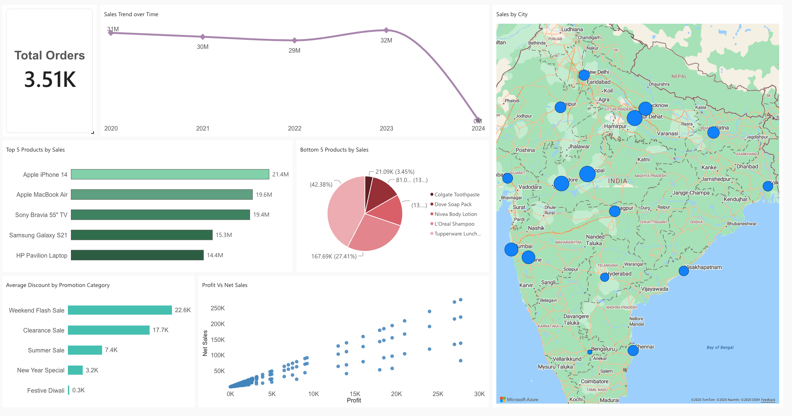
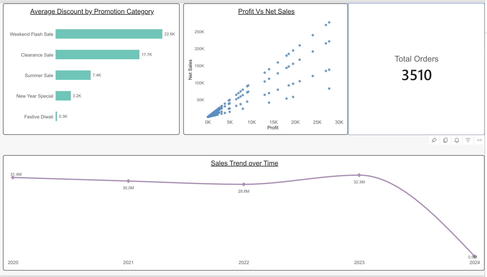
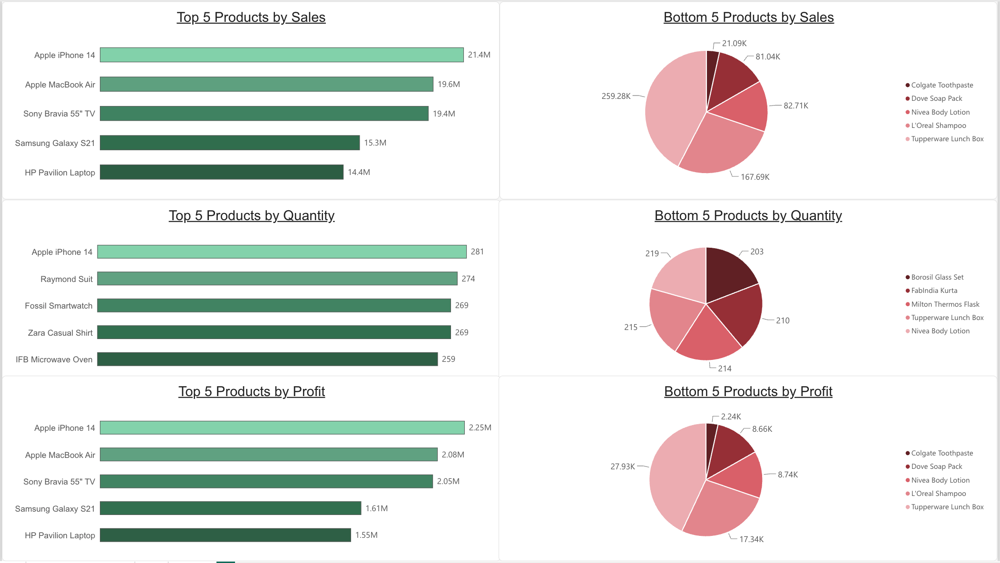
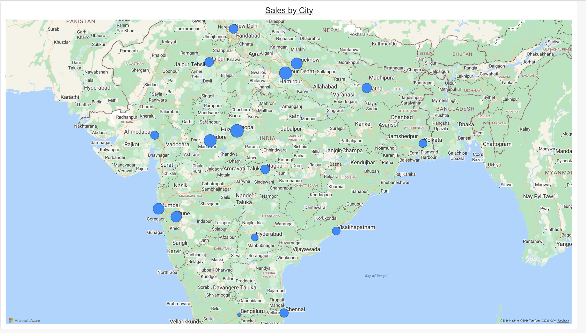
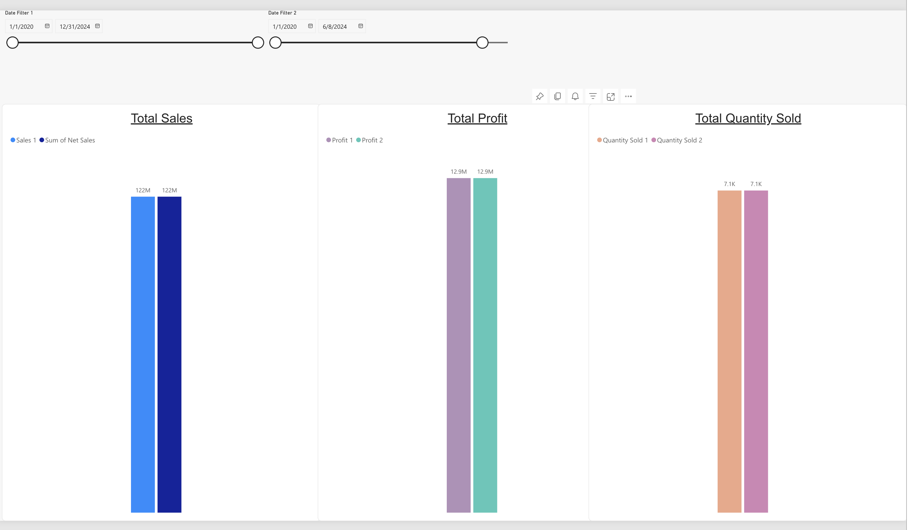
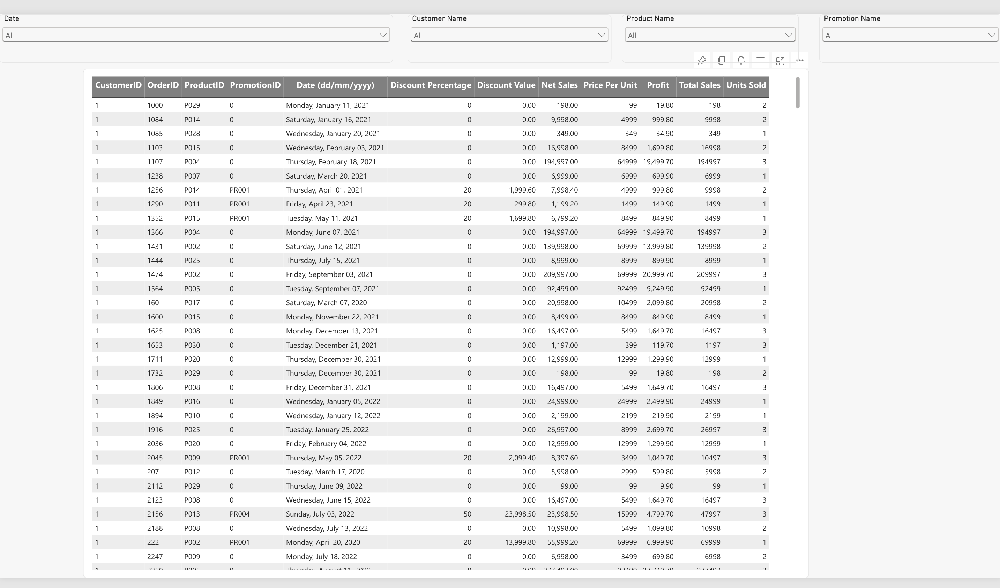

<H1 align="Center">
Sales Data Analysis Report
</H1>
<H3 align="center">
Report Link
  <a href="https://app.powerbi.com/view?r=eyJrIjoiNDY3ZWExMzgtMDk2Zi00MjdmLTk4ZmQtOTMyOGZlMGJiYzk3IiwidCI6ImJkNWY0MGI3LWY2NGMtNDIyNS04YjBkLWM1MTVjZTVlMTNkOCJ9&pageName=e0a23e35e191bc0deea3">
    
  </a>
</H3>

## 📌 Problem Statement 

This report helps the business understand its sales performance. It shows which products drive the most (and least) sales, profit and quantity sold, how sales move over time, how discounts are being used, and where customers are located. By identifying best and worst performers, the business can decide which products to promote, which to review, and where discounting is or isn't paying off.

The report answers the following business requirements:

1. Top / Bottom 5 products by Sales, Profit and Quantity Sold.
2. How sales trends vary over time (daily, monthly, quarterly, annually).
3. The relationship between sales and profit.
4. Comparison of sales, profit and quantity sold between any two periods selected by the user.
5. Average discount offered in each discount (promotion) category.
6. Total number of orders.
7. Order-level details (Sales, Profit, Discount, Net Sales and all remaining fields) that can be filtered using visual filters (Product / Date / Customer / Promotion).
8. Sales by city.

## 📍 Steps followed

- Step 1 : Load the sales data into Power BI Services and prepare it in Power Query.
- Step 2 : Build a star-schema data model with one fact table (`Fact Table`) and the dimension tables `Dim Customers`, `Dim Product`, `Dim Promotion`, `Date Table 1` and `Date Table 2`, and create relationships between them.
- Step 3 : Create a separate `Measures Table` to hold all DAX measures (`Sum of Net Sales`, `Total Profit`, `Total Quantity`).
- Step 4 : Create the fact-table date fields `Year`, `Quater` and `Month`, and a date hierarchy (Year > Quarter > Month > Date) for time analysis.
- Step 5 : In the report view, set the page size (1920 x 1080) and apply a theme.
- Step 6 : **Overview page**
  - A card visual shows the total number of orders (distinct count of `OrderID`) - Requirement 6.
  - A line chart `Sales Trend over Time` uses the date hierarchy, so the user can drill between year, quarter, month and day - Requirement 2.
  - A scatter chart `Profit Vs Net Sales` shows the relationship between sales and profit - Requirement 3.
  - A bar chart `Average Discount by Promotion Category` shows the average discount for each promotion category - Requirement 5.
- Step 7 : **Top/Bottom 5 Products page** - Six bar charts (Top 5 and Bottom 5 for each of Net Sales, Profit and Units Sold) by `Product Name`. The ranking is done with visual-level **Top N filters** - Requirement 1.
- Step 8 : **Comparison page** - Two independent date slicers (`Date Filter 1` and `Date Filter 2`, based on `Date Table 1` and `Date Table 2`) drive column charts for Total Sales, Total Profit and Total Quantity Sold, so two periods can be compared side by side - Requirement 4.
- Step 9 : **Table Visual page** - A table lists every order field (`OrderID`, `CustomerID`, `ProductID`, `PromotionID`, Date, Price Per Unit, Units Sold, Total Sales, Discount Percentage, Discount Value, Net Sales, Profit). Slicers for Product Name, Date, Customer Name and Promotion Name filter the table - Requirement 7.
- Step 10 : **Sales by City page** - A map visual plots Net Sales by customer `City` - Requirement 8.
- Step 11 : Titles were added to the visuals and the layout was aligned on each page.

### 📐 Measures used :

```sql
Sum of Net Sales = CALCULATE(SUM('Fact Table'[Net Sales]),ALL('Date Table 1'),USERELATIONSHIP('Date Table 2'[Date],'Fact Table'[Date (dd/mm/yyyy)]))
```
```sql
Total Profit = CALCULATE(SUM('Fact Table'[Profit]),ALL('Date Table 1'),USERELATIONSHIP('Date Table 2'[Date],'Fact Table'[Date (dd/mm/yyyy)]))
```
```sql
Total Quantity = CALCULATE(SUM('Fact Table'[Units Sold]),ALL('Date Table 1'),USERELATIONSHIP('Date Table 2'[Date],'Fact Table'[Date (dd/mm/yyyy)] ))
```

# Snapshot of the Dashboard


# Snapshots of Report






# 🔎 Insights

A multi-page report (six pages) was created on Power BI Service to visualize key findings of the analysis.

Following inferences can be drawn from the report.

* Total Number of Orders during the period of analysis is 3510.

* The top / bottom analysis was done to identify the most and least products in sales, profit anf quantity aspects.

    Top 5 by Sales
        1. Apple iPhone 14
        2. Apple MacBook Air
        3. Sony Bravia 55" TV
        4. Samsung Galaxy S21
        5. HP Pavilion Laptop

    Bottom 5 by Sales
        1. Colgate Toothpaste
        2. Dove Soap Pack
        3. Nivea Body Lotion
        4. L'Oreal Shampoo
        5. Tupperware Lunch Box

    Top 5 by Profit
        1. Apple iPhone 14
        2. Apple MacBook Air
        3. Sony Bravia 55" TV
        4. Samsung Galaxy S21
        5. HP Pavilion Laptop

    Bottom 5 by Profit
        1. Colgate Toothpaste
        2. Dove Soap Pack
        3. Nivea Body Lotion
        4. L'Oreal Shampoo
        5. Tupperware Lunch Box

    Top 5 by Quantity
        1. Apple iPhone 14
        2. Raymond Suit
        3. Fossil Smartwatch
        4. Zara Casual Shirt
        5. IFB Microwave Oven

    Bottom 5 by Quantity
        1. Borosil Glass Set
        2. FabIndia Kurta
        3. Milton Thermos Flask
        4. Tupperware Lunch Box
        5. Nivea Body Lotion

### [3] Sales Trend

    a) a) Highest sales 
        year - 2023
        quarter - 3rd quarter 
        month - September

    b) Lowest sales 
            year - 2022
            quarter - 3rd quater
            month  - July

    c) Overall sales trend is seasonal for this company

### [4] Sales vs Profit

    In this company, sales and profit are showing a positive relationship. No clear outliers are present.

### [5] Average Discount by Promotion Category

    Weekend Flash Sale - 22.6K
    Clearance Sale - 17.7K
    Summer Sale - 7.4K
    New Year Special - 3.2K
    Festive Diwali - 0.3K

### [6] Sales by City

    Highest sales - Bhopal (15403536.3)
    Lowest sales  - Bangaluru (1549046.0)

### [7] Period Comparison

    Sales, profit and quantity change between the two selected periods change when different dates are selected in the slicers.

Values on the report will change if different visual filters are applied.
